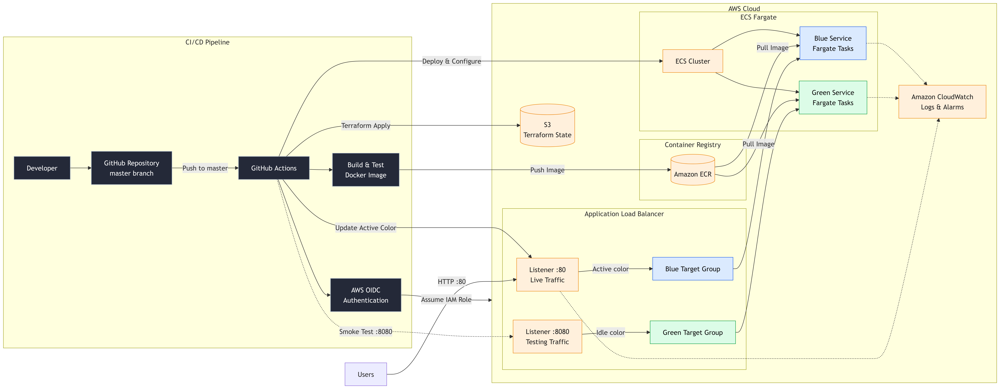
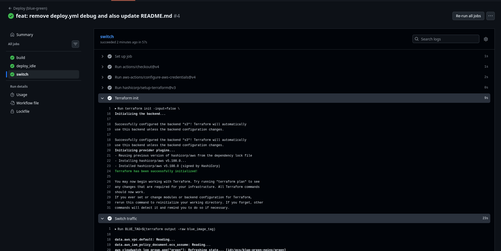
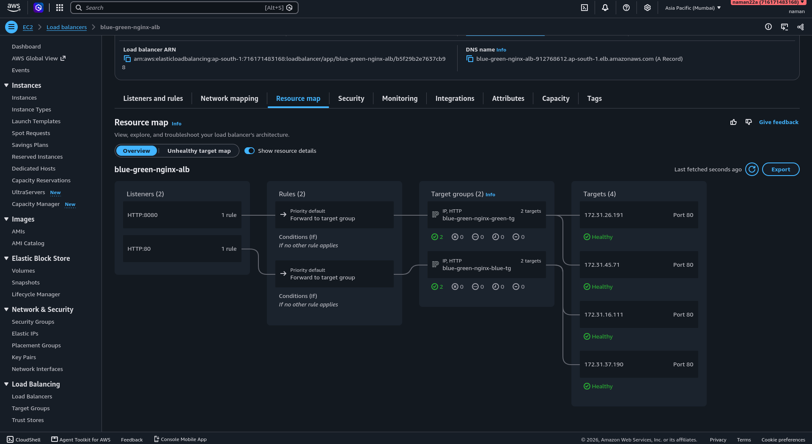
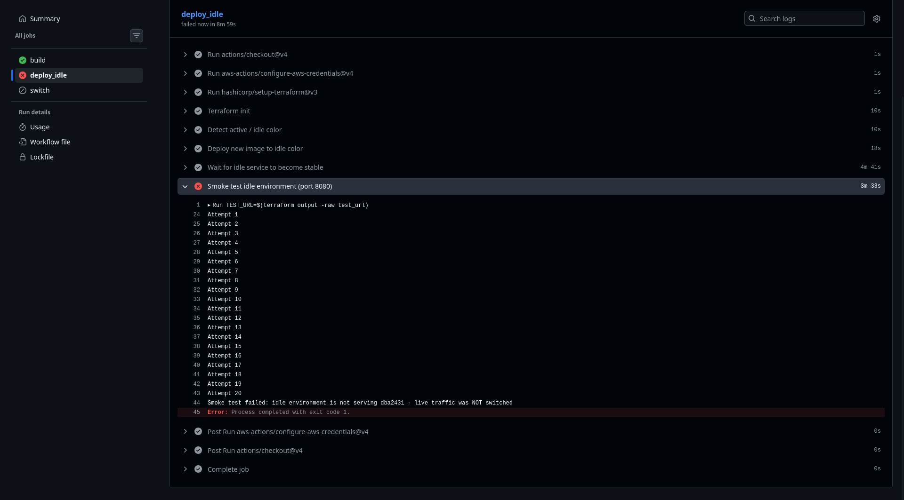

# Blue-Green Deployment on AWS

Zero-downtime deployments for an NGINX app on **Amazon ECS**, fully automated with **Terraform** and **GitHub Actions**. Push to `main`, and the new version is built, deployed alongside the old one, health-checked, and only then given live traffic. If validation fails, traffic never moves.

## How It Works



1. **Build:** GitHub Actions builds the Docker image and pushes it to Amazon ECR, authenticating to AWS through OIDC (no long-lived keys).
2. **Deploy Green:** The new image is deployed to the idle environment while Blue keeps serving users.
3. **Validate:** Health checks and smoke tests run against Green.
4. **Shift traffic:** If checks pass, the Application Load Balancer switches traffic from Blue to Green.
5. **Verify or roll back:** The pipeline confirms the release is healthy. If anything fails, traffic stays on (or returns to) Blue.

## Tech Stack

| Area                   | Tools                                 |
| ---------------------- | ------------------------------------- |
| App                    | NGINX + HTML                          |
| Containers             | Docker, Amazon ECR                    |
| Compute / Routing      | Amazon ECS, Application Load Balancer |
| Infrastructure as Code | Terraform                             |
| CI/CD                  | GitHub Actions (AWS OIDC)             |
| Monitoring             | Amazon CloudWatch                     |

## Project Structure

```text
├── app/                  # NGINX app: index.html, Dockerfile
├── terraform/            # main, variables, outputs, providers, versions
├── .github/workflows/    # ci.yml (build/test), deploy.yml (blue-green deploy)
└── docs/images/          # screenshots used in this README
```

## Getting Started

**Prerequisites:** AWS account, Terraform, Docker, and a GitHub repo with an IAM role configured for OIDC.

```bash
# 1. Run the app locally
docker build -t bluegreen-app ./app
docker run -p 8080:80 bluegreen-app

# 2. Provision AWS infrastructure
cd terraform
terraform init
terraform apply
```

After that, every push to `main` triggers the pipeline. Update `AWS_ROLE_ARN` and `AWS_REGION` in the workflow settings to match your account.

## The Pipeline



## Blue-Green in Action

The same URL, with the version changing and no downtime.

| Before (Blue)                    | After (Green)                      |
| -------------------------------- | ---------------------------------- |
|  |  |



## Failure and Rollback

I intentionally deployed a broken version to confirm the safety net works. Health checks failed, Green never received traffic, and users stayed on Blue.



## Monitoring and Cost

CloudWatch alarms watch for unhealthy targets and elevated error rates so a bad release is visible quickly. All resources are created by Terraform, so teardown is one command:

```bash
cd terraform && terraform destroy
```

## What I Learned

- Using OIDC instead of stored AWS keys removes the biggest CI/CD secret-leak risk.
- Health checks are only useful if the pipeline actually blocks on them.
- Testing the failure path matters as much as the happy path.

## Future Improvements

- Gradual (canary) traffic shifting instead of a full cutover
- Automated rollback triggered by CloudWatch alarms after the switch
- HTTPS with ACM and a custom domain
