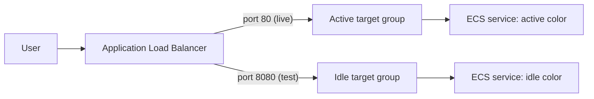

# Blue-Green Deployment on AWS: Setup From Scratch

Automated blue-green deployment of a custom NGINX app using Docker, Amazon ECR, ECS Fargate, an Application Load Balancer, Terraform, GitHub Actions (AWS OIDC), and CloudWatch.

---

## 1. How it works



- Two identical ECS Fargate services exist at all times: **blue** and **green**.
- Port 80 on the ALB forwards to the **active** color (live traffic).
- Port 8080 forwards to the **idle** color, used to smoke-test a new version before it goes live.
- A deployment pushes the new image to the idle color, tests it on 8080, then switches the port 80 listener to it. Rollback is switching back.
- The switch is one Terraform variable: `active_color`.

Pipeline (`deploy.yml`):

1. `build`: build the Docker image, stamp the commit SHA into the page, push to ECR.
2. `deploy_idle`: apply the new image tag to the idle color, wait for the ECS service to stabilize, smoke-test port 8080 (the response must contain the new SHA).
3. `switch`: apply `active_color=<idle>`, then verify the live URL serves the new SHA. This job uses the `production` environment, so it can require manual approval.

`rollback.yml` flips `active_color` back. `terraform-ci.yml` runs `fmt`/`validate` on pull requests.

---

## 2. Repository layout

```
.
├── app/
│   ├── Dockerfile
│   └── index.html
├── terraform/
│   ├── alb.tf            # ALB, two target groups, listeners (80 live, 8080 test)
│   ├── backend.tf        # empty S3 backend (values come from backend.hcl / CI)
│   ├── backend.hcl       # bucket, key, region for local use
│   ├── ecs.tf            # cluster, task definitions, services (blue and green)
│   ├── main.tf           # VPC lookups, ECR, security groups, IAM
│   ├── monitoring.tf     # log groups and CloudWatch alarms
│   ├── outputs.tf
│   ├── providers.tf
│   ├── terraform.tfvars
│   ├── variables.tf
│   └── versions.tf
├── .github/workflows/
│   ├── deploy.yml
│   ├── rollback.yml
│   └── ci.yml
├── .gitignore
└── README.md
```

---

## 3. Prerequisites

- AWS account, and the AWS CLI configured with admin-level access: `aws sts get-caller-identity`
- Terraform **>= 1.10** (needed for S3 native state locking)
- Docker
- `jq`, `curl`
- GitHub CLI (`gh`), logged in: `gh auth login`
- A GitHub account and an empty repo

---

## 4. Values used in this guide

Change these to your own. The commands below use them as shell variables.

```bash
export AWS_REGION=ap-south-1
export ACCOUNT_ID=716171483168
export PROJECT=blue-green-nginx                 # must equal project_name in terraform.tfvars
export STATE_BUCKET=naman22a-remote-bucket      # must be globally unique
export GH_OWNER=naman22a
export GH_REPO=blue-green-deployment-on-aws
export ROLE_NAME=github-actions-bluegreen
```

Three names must match everywhere, or things break in confusing ways:

| Value                                         | Where it appears                                                                                  |
| --------------------------------------------- | ------------------------------------------------------------------------------------------------- |
| `project_name` (= ECR repo name)              | `terraform.tfvars`, `ECR_REPOSITORY` in `deploy.yml`                                              |
| State key `bluegreen-nginx/terraform.tfstate` | `backend.hcl`, and the three `-backend-config="key=..."` lines in `deploy.yml` and `rollback.yml` |
| Role name / ARN                               | IAM, and the `AWS_ROLE_ARN` GitHub secret                                                         |

---

## 5. The app

`app/index.html`:

```html
<!DOCTYPE html>
<html lang="en">
    <head>
        <meta charset="UTF-8" />
        <meta name="viewport" content="width=device-width, initial-scale=1.0" />
        <title>Blue-Green Deployment Demo</title>
    </head>
    <body>
        <h1>Blue-Green Deployment Demo</h1>
        <p>Release: __RELEASE__</p>
    </body>
</html>
```

`app/Dockerfile`:

```dockerfile
FROM nginx:alpine
ARG RELEASE=dev
COPY index.html /usr/share/nginx/html/index.html
RUN sed -i "s/__RELEASE__/${RELEASE}/" /usr/share/nginx/html/index.html
EXPOSE 80
```

The build stamps the release into the page, so the page can only ever say what the image tag says. The pipeline's smoke test relies on this.

Test locally:

```bash
docker build --build-arg RELEASE=local -t bluegreen-test app
docker run --rm -d -p 8081:80 --name t bluegreen-test
sleep 2; curl -s localhost:8081 | grep Release     # Release: local
docker stop t
```

---

## 6. Create the Terraform state bucket (once)

GitHub runners are ephemeral, so state must live in S3.

```bash
aws s3api create-bucket --bucket $STATE_BUCKET --region $AWS_REGION \
  --create-bucket-configuration LocationConstraint=$AWS_REGION
aws s3api put-bucket-versioning --bucket $STATE_BUCKET \
  --versioning-configuration Status=Enabled
```

---

## 7. Bootstrap the infrastructure

Terraform creates the ECR repo and the ECS services in the same config, but the services need an image that already exists. So bootstrap in this order.

`terraform/terraform.tfvars`:

```hcl
aws_region   = "ap-south-1"
project_name = "blue-green-nginx"
```

`terraform/backend.hcl`:

```hcl
bucket       = "naman22a-remote-bucket"
key          = "bluegreen-nginx/terraform.tfstate"
region       = "ap-south-1"
use_lockfile = true
```

**a) Init and create only the ECR repo**

```bash
cd terraform
terraform init -backend-config=backend.hcl
terraform apply -target=aws_ecr_repository.app
```

**b) Build and push the first image**

```bash
ECR=$(terraform output -raw ecr_repository_url)
aws ecr get-login-password --region $AWS_REGION | \
  docker login --username AWS --password-stdin ${ECR%%/*}

docker build --platform linux/amd64 --build-arg RELEASE=v1 -t $ECR:v1 ../app
docker push $ECR:v1
docker run --rm --entrypoint cat $ECR:v1 /usr/share/nginx/html/index.html | grep Release   # must say v1
```

`--platform linux/amd64` matters on Apple Silicon or other ARM machines. Fargate runs x86 here, and an ARM image fails with `exec format error`.

**c) Create everything else**

```bash
terraform apply -var active_color=blue -var blue_image_tag=v1 -var green_image_tag=v1
```

**d) Verify**

```bash
aws ecs wait services-stable --region $AWS_REGION \
  --cluster $(terraform output -raw ecs_cluster_name) \
  --services $(terraform output -json ecs_service_names | jq -r .blue)

curl -s $(terraform output -raw alb_dns_name) | grep Release    # v1 (live, blue)
curl -s $(terraform output -raw test_url)     | grep Release    # v1 (idle, green)
```

If port 80 returns **503**, the active color has no healthy tasks. The usual cause is an image tag that doesn't exist in ECR:

```bash
CLUSTER=$(terraform output -raw ecs_cluster_name)
aws ecs describe-services --region $AWS_REGION --cluster $CLUSTER \
  --services $(terraform output -json ecs_service_names | jq -r .blue) \
  --query 'services[0].events[:5].message' --output text
```

---

## 8. Run a blue-green cycle by hand

Prove the design works before automating it.

```bash
# Build and push v2 (always a NEW tag; never overwrite an old one)
docker build --platform linux/amd64 --build-arg RELEASE=v2 -t $ECR:v2 ../app
docker push $ECR:v2

# Deploy v2 to the idle color (green). Live traffic stays on blue.
terraform apply -var active_color=blue -var blue_image_tag=v1 -var green_image_tag=v2
aws ecs wait services-stable --region $AWS_REGION \
  --cluster $(terraform output -raw ecs_cluster_name) \
  --services $(terraform output -json ecs_service_names | jq -r .green)

curl -s $(terraform output -raw test_url)     | grep Release   # v2
curl -s $(terraform output -raw alb_dns_name) | grep Release   # v1

# Switch traffic
terraform apply -var active_color=green -var blue_image_tag=v1 -var green_image_tag=v2
curl -s $(terraform output -raw alb_dns_name) | grep Release   # v2 (may take a few seconds)

# Roll back
terraform apply -var active_color=blue -var blue_image_tag=v1 -var green_image_tag=v2
curl -s $(terraform output -raw alb_dns_name) | grep Release   # v1
```

Always pass **both** image tags on every apply. Omit one and that color reverts to its default tag.

### Failure test

Build a deliberately broken image (for example, `CMD ["false"]` appended to the Dockerfile), push it as tag `bad`, and deploy it to the idle color. Expected behavior:

- the idle service never stabilizes (the ECS circuit breaker stops it and rolls it back to the previous task definition),
- the idle test URL does not serve the `bad` release,
- live traffic on port 80 is never affected.

Then redeploy a good tag to the idle color.

---

## 9. GitHub Actions setup

### 9.1 Pre-flight checks in the repo

- Default branch is `main` (`git branch -m master main`). `deploy.yml` triggers on pushes to `main`.
- `ECR_REPOSITORY` in `deploy.yml` equals your `project_name` (`blue-green-nginx`).
- The `key=` in the `-backend-config` lines of `deploy.yml` and `rollback.yml` equals the key in `backend.hcl`.
- `terraform fmt -recursive` has been run (CI fails on unformatted code).
- `.gitignore` contains `.terraform/`, `*.tfstate`, `*.tfstate.*`. Commit `.terraform.lock.hcl`.
- Safety check before pushing:
    ```bash
    git ls-files | grep -E 'tfstate|\.terraform/|\.env|\.pem|credentials'    # should print nothing
    git grep -n -E 'AKIA|aws_secret_access_key|BEGIN (RSA|PRIVATE)' || echo clean
    ```

### 9.2 AWS: GitHub OIDC provider (once per account)

```bash
aws iam list-open-id-connect-providers      # skip creation if token.actions.githubusercontent.com is listed

aws iam create-open-id-connect-provider \
  --url https://token.actions.githubusercontent.com \
  --client-id-list sts.amazonaws.com
```

If the CLI asks for a thumbprint, add `--thumbprint-list 6938fd4d98bab03faadb97b34396831e3780aea1`.

### 9.3 AWS: the role GitHub assumes

GitHub may put numeric IDs in the OIDC subject (for example `repo:owner@123/repo@456:...`) instead of the plain `repo:owner/repo:...` form. Get your IDs:

```bash
gh api repos/$GH_OWNER/$GH_REPO --jq '[.owner.id, .id]'
```

Save as `trust-policy.json`. Use the ID form if that is what your repo sends (it was for this project), otherwise use the plain form.

```json
{
    "Version": "2012-10-17",
    "Statement": [
        {
            "Effect": "Allow",
            "Principal": {
                "Federated": "arn:aws:iam::716171483168:oidc-provider/token.actions.githubusercontent.com"
            },
            "Action": "sts:AssumeRoleWithWebIdentity",
            "Condition": {
                "StringEquals": {
                    "token.actions.githubusercontent.com:aud": "sts.amazonaws.com"
                },
                "StringLike": {
                    "token.actions.githubusercontent.com:sub": "repo:naman22a@71423632/blue-green-deployment-on-aws@1435488662:*"
                }
            }
        }
    ]
}
```

Plain form, if your subject has no IDs: `repo:naman22a/blue-green-deployment-on-aws:*`.

The trailing `:*` matters. Jobs that use an environment (the `switch` job) get a subject ending in `:environment:production`, and a branch-only condition would reject them.

Create the role and give it permissions:

```bash
aws iam create-role --role-name $ROLE_NAME \
  --assume-role-policy-document file://trust-policy.json

aws iam attach-role-policy --role-name $ROLE_NAME \
  --policy-arn arn:aws:iam::aws:policy/AdministratorAccess
```

`AdministratorAccess` is broad. It is acceptable for a short-lived personal project, because the trust policy restricts it to your repo. Delete the role when you're done, and say in an interview that you would scope it down for real use.

To update the trust policy later: `aws iam update-assume-role-policy --role-name $ROLE_NAME --policy-document file://trust-policy.json`

### 9.4 GitHub: secret, variables, environment

```bash
gh secret set AWS_ROLE_ARN --body "arn:aws:iam::$ACCOUNT_ID:role/$ROLE_NAME"
gh variable set AWS_REGION --body "$AWS_REGION"
gh variable set TF_STATE_BUCKET --body "$STATE_BUCKET"
```

Create the **production** environment: Settings → Environments → New environment → `production`.

- **Required reviewers** (manual approval before traffic switches) is only available on public repos, or private repos on a paid plan. If the option is missing, the `switch` job simply runs without waiting.
- Under **Deployment branches and tags**, restrict it to `main`.

### 9.5 First run

The first push triggers `deploy.yml`, so do 9.1 to 9.4 and section 7 (bootstrap) first. The pipeline reads outputs from existing state, so it cannot do the very first deploy.

```bash
git remote add origin git@github.com:$GH_OWNER/$GH_REPO.git
git add .
git commit -m "Blue-green deployment pipeline"
git push -u origin main
```

Watch it in the repo's **Actions** tab:

1. `build` pushes an image tagged with the short commit SHA.
2. `deploy_idle` deploys it to the idle color, waits for stability, and smoke-tests port 8080 for that SHA.
3. `switch` waits for approval if a reviewer is configured. Open the run and click **Review deployments**, tick `production`, then **Approve and deploy**. Before approving, you can check the idle color yourself with `curl -s $(terraform output -raw test_url)`.
4. After the switch, the job summary shows which color is live.

### 9.6 Roll back

Actions → **Rollback (switch back to previous color)** → **Run workflow**. It flips `active_color` and keeps both image tags unchanged.

### 9.7 Test a failed deployment through the pipeline

Commit a change that breaks the container (for example, a bad `CMD`) and push to `main`. Expected result: the smoke test on port 8080 fails, the `switch` job never runs, and live traffic stays on the old version.

Note: with the ECS circuit breaker enabled, a failed deployment rolls the idle service back to its previous image, so `aws ecs wait services-stable` can still succeed. The SHA check in the smoke test is what catches this.

---

## 10. Troubleshooting

| Symptom                                                      | Likely cause                                                                                                                                        |
| ------------------------------------------------------------ | --------------------------------------------------------------------------------------------------------------------------------------------------- |
| `terraform init` prompts for a bucket or says region missing | Run `terraform init -backend-config=backend.hcl`. The `key` must not start or end with `/`.                                                         |
| Port 80 returns 503                                          | Active color has no healthy tasks. Check ECS service events. Usually the image tag doesn't exist in ECR (`CannotPullContainerError`).               |
| `exec format error` in task logs                             | Image built for ARM. Rebuild with `--platform linux/amd64`.                                                                                         |
| Both URLs show the same release                              | The image tag was built from a page that already said the other release. Use the stamped Dockerfile and a new tag.                                  |
| Switch applied but `curl` still shows the old release        | The ALB takes a few seconds to apply the listener change. Retry for 30 seconds.                                                                     |
| `Not authorized to perform sts:AssumeRoleWithWebIdentity`    | Trust policy missing or not applied, OIDC provider missing, wrong repo name, or the subject uses the ID format. Print the real subject (see below). |
| `Credentials could not be loaded`                            | `id-token: write` missing or `AWS_ROLE_ARN` secret not set (it must be a repository secret).                                                        |
| `repository ... does not exist` in the build job             | `ECR_REPOSITORY` doesn't match `project_name`.                                                                                                      |
| `terraform output` fails in `deploy_idle`                    | State key mismatch, so CI sees empty state. Or the bootstrap in section 7 wasn't done.                                                              |
| Workflow doesn't start on push                               | Pushed to `master` instead of `main`, or the push didn't touch `app/`, `terraform/`, or the workflow file.                                          |
| No **Required reviewers** option                             | Private repo on a free plan. Make the repo public, or use a separate manual `workflow_dispatch` workflow for the switch.                            |

To print the OIDC subject GitHub actually sends, temporarily add this step before `configure-aws-credentials`, then remove it:

```yaml
- name: Debug OIDC subject
  run: |
      TOKEN=$(curl -sH "Authorization: bearer $ACTIONS_ID_TOKEN_REQUEST_TOKEN" \
        "$ACTIONS_ID_TOKEN_REQUEST_URL&audience=sts.amazonaws.com" | jq -r .value)
      PAYLOAD=$(echo "$TOKEN" | cut -d. -f2 | tr '_-' '/+')
      while [ $(( ${#PAYLOAD} % 4 )) -ne 0 ]; do PAYLOAD="${PAYLOAD}="; done
      echo "$PAYLOAD" | base64 -d | jq '{sub, aud}'
```

Compare the `sub` against the trust policy pattern character by character. It is case-sensitive.

---

## 11. Clean up (stop paying for it)

The ALB and the Fargate tasks cost money while they exist. When you're done:

```bash
cd terraform
terraform destroy          # the ECR repo has force_delete = true, so images are removed too
```

Then remove the rest of the setup, if you're finished with the project:

```bash
# IAM role used by GitHub Actions
aws iam detach-role-policy --role-name $ROLE_NAME \
  --policy-arn arn:aws:iam::aws:policy/AdministratorAccess
aws iam delete-role --role-name $ROLE_NAME

# GitHub OIDC provider (only if nothing else in the account uses it)
aws iam delete-open-id-connect-provider \
  --open-id-connect-provider-arn arn:aws:iam::$ACCOUNT_ID:oidc-provider/token.actions.githubusercontent.com
```

The state bucket is versioned, so it must be emptied of all object versions before it can be deleted. The simplest way is the S3 console: select the bucket, **Empty**, then **Delete**.

Do the bucket last. `terraform destroy` needs the state in it.

After destroying, confirm in the console that no ALB, ECS cluster, or NAT gateway is left over. (This project doesn't create a NAT gateway, so that last one should be empty.)

---

## 12. Known limitations (worth knowing for interviews)

- Both colors run continuously, so you pay for double capacity.
- The switch is all-or-nothing. There is no canary or weighted traffic shifting. ALB weighted target groups could add it.
- Deployments run through Terraform, which mixes infrastructure changes with app releases. Many teams separate them, or use CodeDeploy's native ECS blue-green with automatic rollback.
- Alarms exist, but they have no SNS notification and do not trigger an automatic rollback.
- Tasks run in public subnets of the default VPC, with public IPs, to avoid NAT costs. Port 8080 is open to the internet.
- No HTTPS, ACM certificate, or custom domain.
- The pipeline's IAM role is broad (`AdministratorAccess`).
- No database, so the usual blue-green complication (backward-compatible schema migrations while both versions share a database) is not exercised here.
